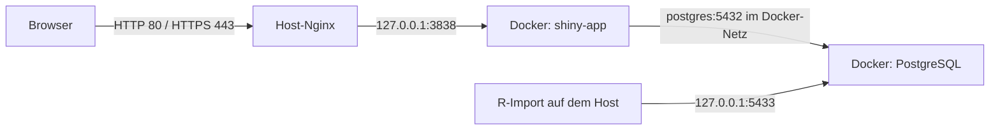

# Deployment und Nginx: Betriebsanleitung für klimahistorie.de

Diese Anleitung beschreibt den Betrieb auf **AlmaLinux 8.10** mit einer
Docker-Shiny-App, einer separaten Docker-PostgreSQL-Datenbank und dem **bereits
auf dem Host installierten Nginx**. Sie erklärt Einrichtung, HTTPS, Wartung und
Fehlerdiagnose auch ohne Nginx-Vorkenntnisse.

Shell-Befehle auf dem Deployment-Server ausführen. Compose- und Importbefehle
gehören ins Projektverzeichnis; R-Code gehört in die R-Konsole. Platzhalter wie
`DEIN_PROJEKTPFAD` ersetzen. Der Entwicklungspfad muss nicht mit dem Pfad auf
dem Deployment-Server übereinstimmen.

## 1. Bestätigter Stand und noch offene Punkte

Stand der Rückmeldungen vom 7. November 2026:

| Thema | Stand |
|---|---|
| Betriebssystem | AlmaLinux 8.10 |
| Domains | `klimahistorie.de`, `www.klimahistorie.de` |
| Reverse Proxy | Vorhandener Host-Nginx, durch systemd verwaltet |
| Konfiguration | `/etc/nginx/conf.d/shiny.conf` |
| HTTP | Laut Betreiber funktioniert die öffentliche App |
| Nginx-Syntaxprüfung und Reload | Erfolgreich ausgeführt |
| Migrationen und ETL-Passwort | Laut Betreiber eingerichtet |
| Stationsimport | Nach Setzen der R-Konfiguration erfolgreich |
| HTTPS | Einrichtung vorgeschlagen, Abschluss noch nicht bestätigt |
| Firewall | `firewall-cmd` nicht verfügbar; andere Regeln nicht geprüft |
| Zertifikatserneuerung und Backups | Einrichtung/Tests noch nicht bestätigt |

Die Serverdiagnose beruht auf den vom Betreiber übermittelten Ausgaben. Diese
Datei behauptet nicht, dass alle folgenden Schritte bereits durchgeführt wurden.

## 2. Architektur und Ports verstehen

Nginx arbeitet als **Reverse Proxy**: Der Browser verbindet sich mit Nginx,
Nginx leitet die Anfrage an Shiny weiter. Dadurch muss Shiny nicht direkt aus
dem Internet erreichbar sein. Bei HTTPS übernimmt Nginx die TLS-Verschlüsselung
der Browserverbindung; zur lokal erreichbaren App geht es über HTTP weiter.



| Verbindung | Adresse | Öffentlich? |
|---|---|---|
| Browser → Nginx | Domain, TCP 80/443 | Ja |
| Host-Nginx → Shiny | `127.0.0.1:3838` | Nein |
| Shiny → App-Datenbank | `postgres:5432` | Nein, Docker-Netz |
| R-Import auf dem Host → App-Datenbank | `127.0.0.1:5433` | Nein |
| Bereits separat installierte PostgreSQL-Instanz | Host-Port 5432 | Nicht Teil der App-Datenbank |

`127.0.0.1` bezeichnet immer den jeweiligen Rechner bzw. Container. Im
Host-Nginx ist das der Server, in einem Nginx-Container der Nginx-Container selbst.
**Host-Nginx → `127.0.0.1:3838`; Docker-Nginx → `shiny-app:3838`.**

Shiny benötigt WebSockets: länger offene Verbindungen für interaktive Eingaben
und Ergebnisse. Eine ladende Startseite allein beweist nicht, dass diese funktionieren.

### Hier keinen zusätzlichen Docker-Nginx starten

`docker-compose.yml` enthält noch den alternativen Service `nginx`, der ebenfalls
Ports 80/443 veröffentlichen möchte. Der Host-Nginx belegt bereits Port 80.
Zwei Dienste können nicht denselben Port auf derselben Adresse binden.

Für diese Architektur deshalb ausdrücklich starten:

```bash
docker compose up -d postgres shiny-app
```

**Nicht einfach `docker compose up -d` verwenden:** Das würde auch den
Compose-Nginx starten und kann den bekannten Portkonflikt auslösen. Die Compose-
Datei wurde bisher nicht auf einen ausschließlich hostbasierten Proxy umgebaut.
Den vorhandenen Host-Nginx nicht stoppen; andere Dienste könnten ihn benötigen.

## 3. Dateien und Verantwortlichkeiten

| Datei/Ort | Bedeutung |
|---|---|
| `Dockerfile` | Baut die App mit R-Paketen und Systembibliotheken |
| `docker/renv.lock` | Fixierte R-Paketversionen für das Image |
| `docker/update-lock.R` | Aktualisierung aus dem Projekt-Lockfile |
| `.dockerignore` | Allowlist für R-Code und aktive CSS/JS/PNG/JPG-Assets |
| `docker-compose.yml` | Dienste, Netze, Portbindungen und Secrets |
| `shiny/` | Aktuelle App, die ins Image kopiert wird |
| `shiny_old/` | Referenz, nicht die produktive App |
| `db/migrations/` | Versioniertes Datenbankschema |
| `etl/` | Importiert Stationsmetadaten und Tagesmessungen |
| `secrets/` | Lokale Passwortdateien, nicht in Git |
| `.Renviron` | Lokale R-Einstellungen für Host-Imports, nicht in Git |
| `/etc/nginx/conf.d/shiny.conf` | Aktive Host-Nginx-Konfiguration |
| `/etc/letsencrypt/` | Certbot-Zertifikate und Schlüssel, sofern eingerichtet |

App-Codeänderungen benötigen einen Image-Neubau und Neuerstellung des
App-Containers. Nginx-Konfigurationsänderungen benötigen dagegen Syntaxprüfung
und Reload. Die alternative Docker-Konfiguration unter `nginx/` im Repository
wird vom Host-Nginx nicht automatisch gelesen.

## 4. App und Datenbank einrichten

### Repository und Voraussetzungen

Der bisher verwendete Branch ist `feat/bslib-migration`. Nach einem Merge kann
ein anderer freigegebener Branch oder ein Release verwendet werden.

```bash
git clone --branch feat/bslib-migration \
  https://github.com/TobiasKellner/klimahistorie.de.git
cd klimahistorie.de
docker --version
docker compose version
```

Für die App ist kein R auf dem Host erforderlich. Für Host-Imports wird eine
separate R-Umgebung mit den ETL-Abhängigkeiten benötigt; siehe
[ETL-Anleitung](../etl/README.md).

### Passwortdateien nur bei der Erstinstallation erzeugen

**Bestehende Passwortdateien nicht überschreiben.** Eine neue Datei ändert nicht
automatisch das Passwort einer Rolle in einem vorhandenen PostgreSQL-Volume.

```bash
mkdir -p secrets
chmod 700 secrets
for name in postgres_admin_password postgres_app_password postgres_etl_password; do
  if [ ! -e "secrets/$name" ]; then
    (umask 077; set -C; openssl rand -hex 32 > "secrets/$name") || exit 1
  fi
done
chmod 444 secrets/postgres_admin_password secrets/postgres_app_password
chmod 600 secrets/postgres_etl_password
```

Der Block erzeugt nur fehlende Dateien. Das private Host-Verzeichnis schützt sie.
Die beiden Container-Dateimounts müssen für unterschiedliche Container-UIDs lesbar
sein; deshalb sind hier Admin-/App-Dateimodi 444 gewählt. Die ETL-Datei mit Modus
600 muss dem Linux-Benutzer gehören, der den Import ausführt. Andere Plattformen
sollten ihr eigenes Secret-Management verwenden.

Compose erwartet alle drei Dateien. Jede enthält genau eine nichtleere Zeile.
Passwörter nicht in Git, Chat, Befehlsargumente oder `.Renviron` schreiben.

### PostgreSQL und Migrationen

```bash
docker compose config --quiet
docker compose up -d postgres
docker compose ps
```

Warten, bis PostgreSQL `healthy` meldet. Bei einer frischen Datenbank:

```bash
bash db/migrate.sh
bash db/set-etl-password.sh
```

Migrationen erzeugen Tabellen, Rollen und Stations-View; der zweite Befehl setzt
das ETL-Passwort. Die App nutzt `climate_reader` mit Leserechten, Imports nutzen
`climate_etl`, Migrationen den Administrator. Unveränderte angewendete Migrationen
werden übersprungen. Bestehende alte Tabellen ohne Migrationshistorie benötigen
eine bewusste Übernahme, nicht Löschen; siehe [Datenbankanleitung](../db/README.md).

### Dauerhafte Konfiguration der Host-Imports

In der Projektwurzel lokal eine `.Renviron` erstellen:

```text
PGHOST=127.0.0.1
PGPORT=5433
PGDATABASE=klimahistorie
PGUSER=climate_etl
DB_PASSWORD_FILE=/DEIN_PROJEKTPFAD/secrets/postgres_etl_password
```

Den tatsächlichen absoluten Dateipfad in R aus der Projektwurzel ermitteln:

```r
normalizePath("secrets/postgres_etl_password", mustWork = TRUE)
```

R lädt `.Renviron` beim Start aus dem entsprechenden Projektverzeichnis. Für
eine laufende Sitzung einmal `readRenviron(".Renviron")` verwenden. Anschließend:

```r
source("etl/Import_station_table.R")
source("etl/Import_climate_data.R")
```

Der vollständige Tagesimport kann viel Zeit und Speicher benötigen. Für Testläufe
bietet die ETL-Anleitung eine Begrenzung auf wenige Stationen. Migrationen allein
enthalten keine Messdaten. Die Shiny-Docker-Verbindung wird unabhängig davon
durch Compose gesetzt; `.Renviron` wird nicht ins Image kopiert.

### App bauen und testen

```bash
docker compose build shiny-app
docker compose up -d postgres shiny-app
docker compose ps
docker compose logs --tail=100 shiny-app
curl -I http://127.0.0.1:3838
```

`healthy` und HTTP 200 zeigen Startbereitschaft, testen aber keine vollständige
Shiny-Sitzung oder Datenabdeckung. Im Browser auch Stationen, Diagramme und Karten
prüfen. Eine neue Portbindung wird erst nach Neuerstellung des entsprechenden
Containers wirksam; bestehende Datenvolumes bleiben dabei erhalten.

## 5. Host-Nginx verstehen und bearbeiten

Auf diesem Server fehlt `/etc/nginx/sites-enabled`. Das ist kein Problem: Nginx-
Installationen verwenden unterschiedliche Verzeichnislayouts. Die gemeldete
Site liegt unter `/etc/nginx/conf.d/shiny.conf`.

```bash
sudo ls -l /etc/nginx/conf.d
sudo cat /etc/nginx/conf.d/shiny.conf
sudo nginx -t
sudo systemctl status nginx
```

`nginx -t` prüft die gesamte geladene Konfiguration. `nginx -T` gibt sie zusätzlich
aus; diese Ausgabe nicht ungeprüft teilen, weil auch andere Sites und vertrauliche
Einstellungen enthalten sein können.

### HTTP-Ausgangspunkt mit WebSockets und Timeouts

Die gemeldete Konfiguration hatte bereits passende Domain, Proxyziel und
WebSocket-Header. Folgende Version ergänzt die empfohlenen Timeouts und schaltet
Antwortpufferung aus:

```nginx
server {
    listen 80;
    server_name klimahistorie.de www.klimahistorie.de;

    location / {
        proxy_pass http://127.0.0.1:3838/;
        proxy_http_version 1.1;
        proxy_set_header Upgrade $http_upgrade;
        proxy_set_header Connection "upgrade";
        proxy_set_header Host $host;
        proxy_set_header X-Real-IP $remote_addr;
        proxy_set_header X-Forwarded-For $proxy_add_x_forwarded_for;
        proxy_set_header X-Forwarded-Proto $scheme;
        proxy_read_timeout 3600s;
        proxy_send_timeout 3600s;
        proxy_buffering off;
    }
}
```

Dies ist eine **HTTP-Konfiguration**, noch kein HTTPS. Nach Certbot nicht blind
wieder diese Version über die erzeugte HTTPS-Konfiguration kopieren.

| Direktive | Erklärung |
|---|---|
| `server` | Regeln für eine Website/einen virtuellen Server |
| `listen 80` | HTTP-Listener, kein HTTPS |
| `server_name` | Zuständige Hostnamen; legt keine DNS-Einträge an |
| `location /` | Behandelt die Wurzel und untergeordnete Pfade |
| `proxy_pass` | Weiterleitung zur lokal veröffentlichten Docker-App |
| `proxy_http_version 1.1` | Für WebSocket-Upgrades benötigte HTTP-Version |
| `Upgrade`, `Connection` | Reicht WebSocket-Upgrades weiter |
| `Host`, `X-Forwarded-*` | Ursprünglicher Host, Clientadresse und Verbindungsschema |
| `proxy_read_timeout` | Wartezeit zwischen Lesevorgängen zum Upstream, kein garantiertes Sitzungsalter |
| `proxy_send_timeout` | Wartezeit zwischen Schreibvorgängen zum Upstream |
| `proxy_buffering off` | Verhindert unnötiges Puffern der Antworten |

`Connection "upgrade"` entspricht der bisherigen einfachen Shiny-Konfiguration.
Größere Multi-Site-Proxys können eine bedingte `map`-Direktive verwenden; diese
muss dann im `http`-Kontext und nicht einfach im `location`-Block stehen.

### Sicher ändern: Backup → Bearbeiten → Prüfen → Reload

```bash
sudo cp -a /etc/nginx/conf.d/shiny.conf \
  "/etc/nginx/conf.d/shiny.conf.backup-$(date +%Y%m%d-%H%M%S)"
sudoedit /etc/nginx/conf.d/shiny.conf
sudo nginx -t
```

Nur bei erfolgreicher Prüfung:

```bash
sudo systemctl reload nginx
sudo systemctl status nginx
```

Reload übernimmt Änderungen normalerweise ohne abrupten Abbruch aller
Verbindungen; Restart stoppt und startet den Dienst. Bei Fehlern nicht reloaden,
sondern korrigieren oder die Sicherung zurückkopieren. Backups nicht auf `.conf`
enden lassen, damit sie nicht über den üblichen `*.conf`-Include zusätzlich
geladen werden. Fremde Site-Konfigurationen nicht überschreiben.

## 6. HTTPS mit Let’s Encrypt und Certbot

HTTPS verschlüsselt die Browserverbindung und verwendet ein zur Domain passendes
Zertifikat. Es ersetzt keine Benutzeranmeldung. Let’s Encrypt stellt Zertifikate
aus; Certbot beantragt und erneuert sie. Das Nginx-Plugin kann die Proxy-
Konfiguration passend ändern.

### Voraussetzungen: DNS und Firewall

Beide Domains müssen öffentlich auf diesen Server zeigen. Ein vorhandener
AAAA-Eintrag muss auf eine funktionierende IPv6-Adresse zeigen; ein falscher
AAAA-Eintrag kann die Validierung trotz korrekter IPv4-Adresse verhindern. CAA-
Regeln müssen Let’s Encrypt zulassen. Wenn `www` noch nicht eingerichtet ist,
erst DNS ergänzen oder zunächst nur die eingerichtete Domain beantragen.

Bei verfügbaren DNS-Werkzeugen prüfen:

```bash
dig +short A klimahistorie.de
dig +short AAAA klimahistorie.de
dig +short A www.klimahistorie.de
dig +short AAAA www.klimahistorie.de
```

TCP 80 muss für die HTTP-Validierung erreichbar bleiben; TCP 443 wird für HTTPS
benötigt. In dieser Sitzung fehlte `firewall-cmd`. Das beweist nicht, dass keine
Firewall existiert: Regeln können über nftables/iptables oder beim Anbieter gelten.

**Nicht vorschnell firewalld installieren und aktivieren.** Das könnte SSH,
Docker und bestehende Dienste beeinflussen. Im Anbieterportal TCP 80/443 prüfen;
vor Host-Firewalländerungen SSH-Zugang und Anbieter-Konsole zur Wiederherstellung
sicherstellen. Listener prüft:

```bash
sudo ss -ltnp '( sport = :80 or sport = :443 )'
```

Ein Listener beweist noch keine externe Firewallfreigabe. Zusätzlich extern testen.

### Certbot auf AlmaLinux 8.10 installieren

```bash
sudo dnf install -y epel-release
sudo dnf install -y certbot python3-certbot-nginx
command -v certbot
sudo certbot certificates
```

Falls Pakete fehlen, Repository-/EPEL-Konfiguration prüfen, statt ungeprüfte
Installationsskripte auszuführen. Vorhandene Zertifikate, deren Domains und
Ablaufdaten prüfen, bevor neue Zertifikate angefordert werden.

Konfiguration wie oben sichern und `nginx -t` ausführen. Danach:

```bash
sudo certbot --nginx \
  -d klimahistorie.de \
  -d www.klimahistorie.de \
  --redirect
```

Certbot fragt nach Kontakt-E-Mail und Zustimmung zu den Bedingungen. Das Plugin
richtet HTTPS ein; `--redirect` leitet HTTP auf HTTPS um. Bei Validierungsfehlern
DNS, Erreichbarkeit und konkrete Fehlermeldung prüfen, nicht blind wiederholen:
Zertifikatsausstellungen unterliegen Limits.

Certbot verwaltet Dateien unter `/etc/letsencrypt/`. Der konkrete Zertifikatsname
kann abweichen; `sudo certbot certificates` zeigt Pfade und Namen. **Private
Schlüssel nicht ins Repository kopieren oder im Chat teilen.** Die Host-Variante
benötigt keine Zertifikatskopien unter `nginx/ssl/` im Repository.

### HTTPS und Umleitung prüfen

```bash
sudo nginx -t
sudo systemctl reload nginx
sudo ss -ltnp '( sport = :80 or sport = :443 )'
curl -I http://klimahistorie.de
curl -I https://klimahistorie.de
curl -I https://www.klimahistorie.de
```

HTTP sollte mit 301/308 auf HTTPS umleiten. HTTPS soll ohne Zertifikatswarnung
funktionieren. Fehler nicht durch `curl -k` verdecken. Im externen Browser
zusätzlich Shiny-Eingaben und Diagramme testen; curl allein prüft keine WebSockets.

### Automatische Zertifikatserneuerung

Zertifikate gelten nur begrenzt. Einmalige Ausstellung ohne Erneuerung genügt
nicht für dauerhaften Betrieb.

```bash
systemctl list-unit-files | grep -E 'certbot.*timer'
systemctl list-timers --all | grep -i certbot
```

Nur wenn tatsächlich `certbot-renew.timer` vorhanden ist:

```bash
sudo systemctl enable --now certbot-renew.timer
```

Bei anderem Namen den vorhandenen Timer verwenden. Ohne Timer Paketkonfiguration
und gegebenenfalls Cron prüfen; nicht mehrere konkurrierende Jobs einrichten.

```bash
sudo certbot renew --dry-run
sudo certbot certificates
```

Der Dry-run prüft die Erneuerbarkeit. Nach echter Erneuerung muss Nginx außerdem
das neue Zertifikat laden. Das Nginx-Plugin verwaltet dies normalerweise; bei
abweichender früherer Einrichtung die Erneuerungskonfiguration/Deploy-Hooks
prüfen. Eine nötige manuelle Hook-Aktion ist Syntaxprüfung und erst danach Reload,
also `nginx -t` gefolgt von `systemctl reload nginx`. Timerstatus allein beweist
weder erfolgreiche Validierung noch Reload. Ablaufdaten und Jobfehler überwachen.

## 7. Updates und Wiederanlauf

Vor Änderungen aktuellen Stand notieren:

```bash
git status --short
git rev-parse HEAD
docker compose images shiny-app
```

Lokale Änderungen nicht mit einem harten Reset überschreiben. App-Update auf dem
bisher verwendeten Branch:

```bash
git pull --ff-only origin feat/bslib-migration
docker compose build shiny-app
docker compose up -d --no-deps shiny-app
docker compose ps
docker compose logs --tail=100 shiny-app
curl -I http://127.0.0.1:3838
```

Der Build ersetzt die laufende App nicht; erst `up` erstellt den Container neu.
Dabei gehen laufende Shiny-Sitzungen verloren, deshalb Wartungsfenster wählen.
`--no-deps` passt hier nur, wenn die Datenbank bereits läuft und lediglich die
App aktualisiert wird. Nginx braucht für reine App-Updates normalerweise keinen Reload.

Neue Migrationen bewusst nach Backup und Kompatibilitätsprüfung mit
`bash db/migrate.sh` ausführen. Ein App-Rollback macht Schemaänderungen nicht
automatisch rückgängig. Bei neuen R-Paketen Projekt-Lockfile bewusst aktualisieren,
in R `source("docker/update-lock.R")` ausführen, benötigte Systembibliotheken
prüfen und neu bauen. Neue Assettypen gegebenenfalls in `.dockerignore` zulassen.

Compose verwendet `restart: unless-stopped`. Für Wiederanlauf nach Serverneustart
müssen Docker und Host-Nginx als Systemdienste gestartet werden; deren Aktivierung
prüfen. Absichtlich gestoppte Container werden durch diese Policy nicht einfach
wieder gestartet. Keine fremden Dienste auf dem Server verändern.

## 8. Backups und Wiederherstellung

Ein Volume ist **kein Backup**. Regelmäßige externe Kopien und ein getesteter
Restore sind nötig. Beispiel für einen Datenbankdump außerhalb des Repositories:

```bash
mkdir -p /DEIN_BACKUPPFAD
chmod 700 /DEIN_BACKUPPFAD
(
  umask 077
  docker compose exec -T postgres pg_dump -U postgres -d klimahistorie -Fc \
    > "/DEIN_BACKUPPFAD/klimahistorie-$(date +%Y%m%d-%H%M%S).dump"
)
```

Pfad ersetzen, Exitstatus und Dateigröße prüfen, dann sicher auf ein anderes
System kopieren. Ein Datenbankdump enthält nicht automatisch alle clusterweiten
Rollen. Rollen, Grants und Passwortzuordnung müssen beim Restore berücksichtigt
werden. Ein ergänzendes Rollenbackup kann sensible Passworthashes enthalten.

Restore zunächst gegen eine **separate Testdatenbank**, nicht mit ungeprüften
löschenden Optionen gegen Produktion durchführen. Vorab festlegen, ob Schema
aus Dump oder Migrationen stammt; beide Erstaufbauten nicht blind überlagern.
Auch Host-Nginx-/Certbot-Konfiguration und Secrets geschützt sichern oder
reproduzierbar einrichten; private Schlüssel und Passwörter nicht in Git ablegen.

**Kein `docker compose down -v` oder unüberlegtes `docker volume rm`:** Diese
Befehle können Daten löschen. Container-Neuerstellung erhält das Datenvolume;
PostgreSQL-Major-Upgrades brauchen dagegen eine geplante Migration, nicht nur
einen neuen Image-Tag.

## 9. Fehlerdiagnose von innen nach außen

Zuerst Container/App, danach lokalen Proxy, anschließend DNS/TLS und externe
Erreichbarkeit prüfen:

```bash
docker compose ps -a
docker compose logs --tail=100 shiny-app postgres
curl -I http://127.0.0.1:3838
curl -I -H 'Host: klimahistorie.de' http://127.0.0.1
sudo nginx -t
sudo systemctl status nginx
sudo journalctl -u nginx --since '30 minutes ago'
```

Der Aufruf mit `Host` prüft den lokalen Domainblock; nach HTTPS-Einrichtung ist
eine HTTP-Umleitung normal. HTTPS lokal mit korrektem Hostnamen/SNI prüfen:

```bash
curl -I --resolve klimahistorie.de:443:127.0.0.1 https://klimahistorie.de
```

Zusätzlich von einem anderen Rechner testen: Nur externe Tests prüfen den
tatsächlichen Weg über öffentliche DNS-Einträge und Anbieter-Firewall.

| Fehler/Symptom | Diagnose und Maßnahme |
|---|---|
| `address already in use` auf Port 80 | Host-Nginx belegt den Port; keinen zusätzlichen Docker-Nginx starten |
| `host not found in upstream "shiny-app"` | Docker-Upstream fehlt im gemeinsamen Compose-Netz; Host-Nginx verwendet stattdessen `127.0.0.1:3838` |
| `502 Bad Gateway` | App nicht erreichbar; direkten App-Aufruf, Container und Logs prüfen |
| `504 Gateway Timeout` | App/DB zu langsam oder blockiert; Last, Fehler und Timeouts prüfen |
| Startseite lädt, Eingaben ohne Wirkung | WebSocket-Header, Browser-Netzwerkfehler, Timeouts und App-Logs prüfen |
| HTTPS-Verbindung abgelehnt | Listener 443 oder Firewallfreigabe fehlt |
| Zertifikatswarnung | Falsche Domain, abgelaufenes Zertifikat oder falsche Kette/Serverblock |
| Certbot-Validierung scheitert | DNS A/AAAA, Port 80, CAA und konkrete Meldung prüfen |
| `firewall-cmd` fehlt | Werkzeug nicht vorhanden; sagt nichts über andere Firewallregeln aus |
| Passwortdatei nicht lesbar/eine Zeile | R-Pfad, Eigentümer, Modus und Format prüfen, ohne Passwort auszugeben |
| Keine Stationen/Messwerte | Migrationen, Stationen-/Tagesimport und Datenabdeckung prüfen |

### Portkonflikte erkennen

```bash
sudo ss -ltnp '( sport = :80 or sport = :443 )'
docker ps --format 'table {{.Names}}\t{{.Ports}}'
```

Beim Deployment belegten Host-Nginx-Prozesse Port 80. Andere Container gehörten
Airflow und Portainer. Deren Dienste nicht ohne Prüfung stoppen.

Der frühere Test `docker compose run --rm --no-deps nginx nginx -t` gehörte zur
alternativen Docker-Proxy-Variante. `--no-deps` startet Shiny nicht mit, wodurch
der Upstreamname fehlen kann. Die Entrypoint-Info zur read-only gemounteten
`default.conf` war nicht der eigentliche Fehler. Hier den **Host-Nginx mit
`sudo nginx -t`** prüfen.

### Logs und SELinux

Übliche, aber konfigurierbare Nginx-Logpfade sind `/var/log/nginx/access.log`
und `/var/log/nginx/error.log`:

```bash
sudo tail -n 100 /var/log/nginx/error.log
sudo journalctl -u nginx --since '30 minutes ago'
```

Bei Upstream-`Permission denied` kann SELinux beteiligt sein. Nicht pauschal
deaktivieren, sondern prüfen:

```bash
getenforce
getsebool httpd_can_network_connect
sudo ausearch -m AVC -ts recent
```

Nur bei bestätigter passender Blockade kann nötig sein:

```bash
sudo setsebool -P httpd_can_network_connect on
```

Das erweitert Netzwerkrechte des HTTP-Dienstes und ist eine bewusste
Sicherheitsentscheidung, kein pauschaler Standard-Fix. Auch Zertifikats-Dateikontexte
können relevant sein; nicht als Ersatz alle Dateiberechtigungen öffnen.

### Passwortdiagnose ohne Geheimnisse auszugeben

In der betroffenen R-Konsole:

```r
local({
  path <- Sys.getenv("DB_PASSWORD_FILE")
  lines <- tryCatch(readLines(path, warn = FALSE), error = function(e) NULL)
  data.frame(
    konfiguriert = nzchar(path),
    vorhanden = file.exists(path),
    lesbar = file.access(path, 4) == 0,
    genau_eine_nichtleere_zeile =
      length(lines) == 1L && nzchar(lines[[1L]])
  )
})
```

Ein leerer Pfad wird durch `.Renviron` oder Sitzungskonfiguration behoben.
Host-Imports benötigen den Host-Dateipfad, nicht `/run/secrets/...` aus einem
Container. Keine Passwortwerte, privaten Schlüssel oder ungeprüften vollständigen
Konfigurationen veröffentlichen.

## 10. Abnahme und täglicher Betrieb

Vollständige Abnahme bedeutet: beide Domains über HTTPS ohne Warnung erreichbar,
HTTP-Umleitung aktiv, Stationen und Messwerte vorhanden, interaktive Diagramme
und Karten funktionieren. Zusätzlich Erneuerung, Ablaufüberwachung, externe
Backups und Restore-Test einrichten. Ein HTTP-Healthcheck allein genügt nicht.

```bash
docker compose ps
docker compose logs --tail=50 shiny-app
sudo systemctl status nginx
sudo certbot certificates
systemctl list-timers --all | grep -i certbot
```

Die App verwendet derzeit einen R-Prozess pro Container. Aufwendige Operationen
können andere Sitzungen beeinflussen. Mehrere Instanzen benötigen Shiny-gerechtes
Sitzungsrouting; horizontale Skalierung gehört nicht zu dieser Anleitung.

Weitere Dokumentation: [Docker](README.md), [Migrationen](../db/README.md),
[ETL](../etl/README.md), [App und Tests](../shiny/README.md).
